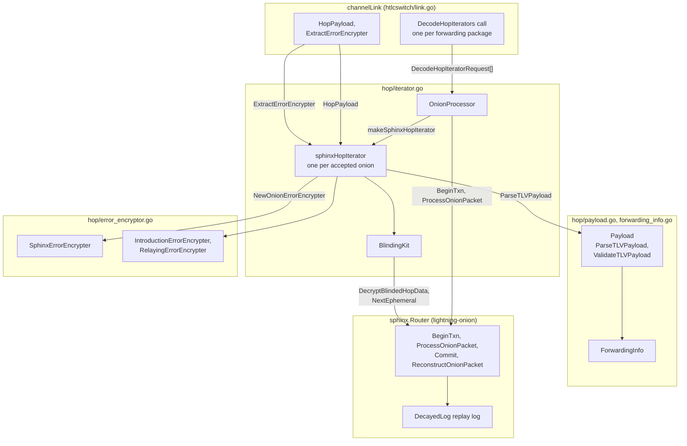
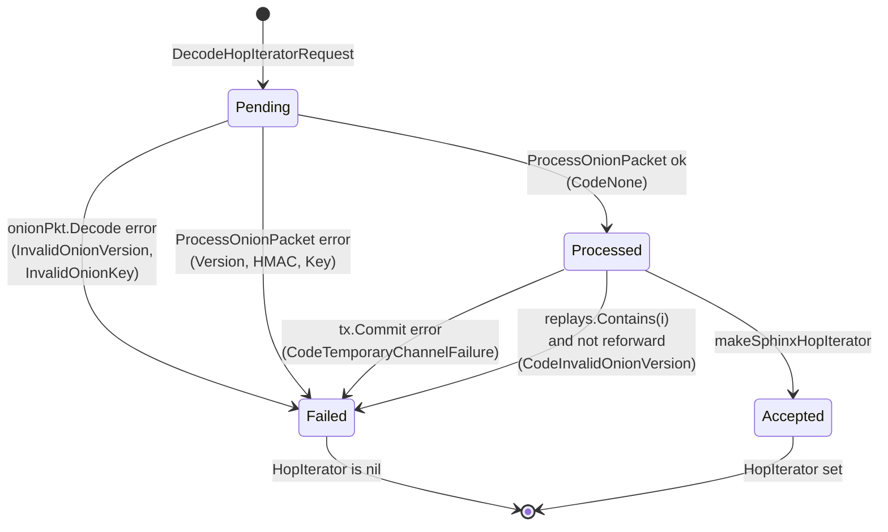
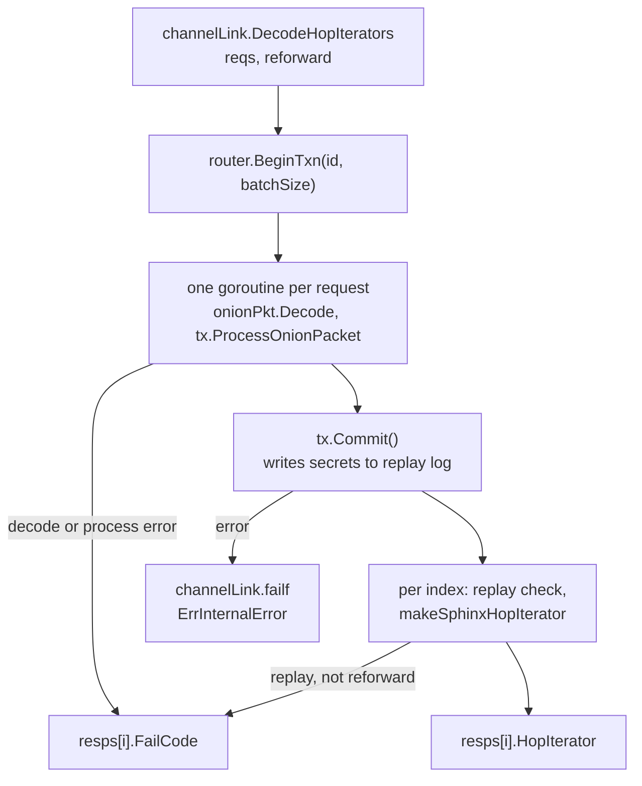
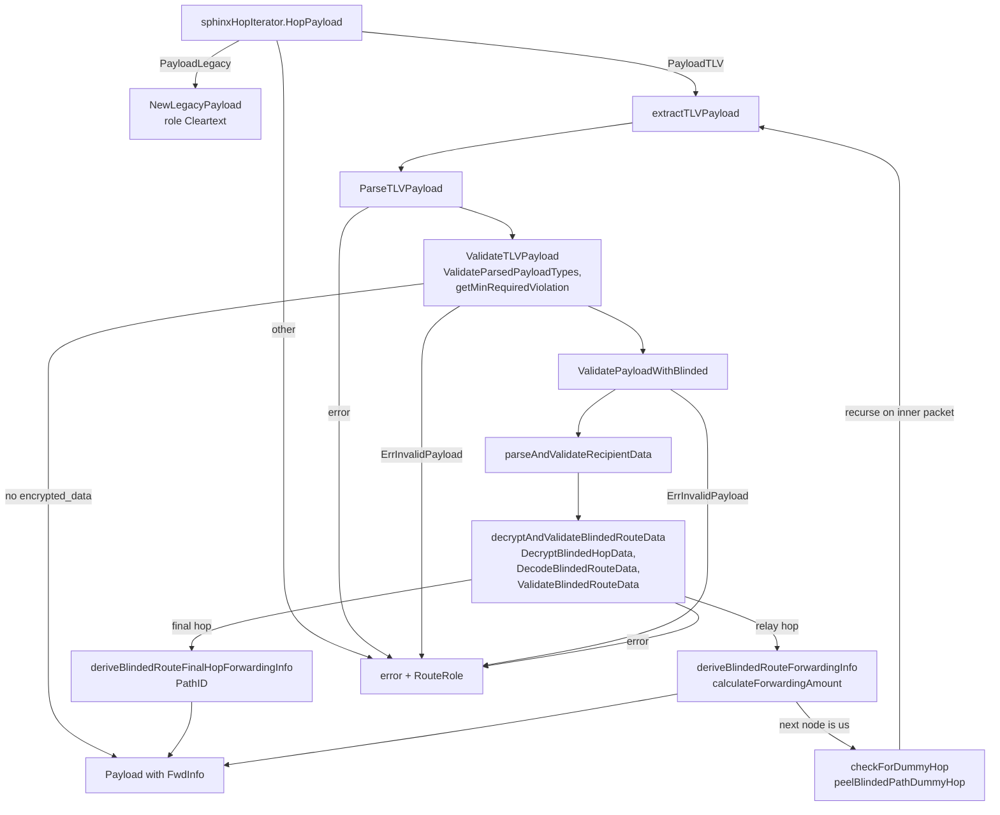
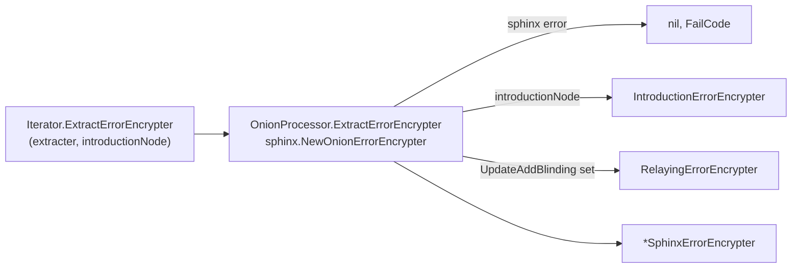

# HTLC Onion Hop Architecture

The `htlcswitch/hop` package turns the onion packet of an incoming HTLC into
three things the link can act on: a `Payload` that says what to do with the
HTLC, a `RouteRole` that says whether the node is inside a blinded route, and
an `ErrorEncrypter` that wraps any failure on its way back to the sender.
This document describes the components that do that work, who owns which
state, and how a batch of onions moves from `channelLink` to a decoded hop.
It reflects lnd at commit `0d9c9d3afb`.

For the wire format, see BOLT 4 (onion routing) and BOLT 4's blinded path
section.

## Components

`OnionProcessor` is the entry point. It wraps one `sphinx.Router`, which
performs the cryptography and owns the replay log, and it produces
`Iterator` values that `channelLink` reads. The payload types and the error
encrypters live in the same package but are used independently once an
iterator exists.

The package does not make forwarding decisions. `channelLink` compares the
payload with the incoming HTLC and the channel policy, and maps
`ErrInvalidPayload` to a BOLT 4 failure code.

### Responsibilities

| Type | Owns | Does not own |
| --- | --- | --- |
| `OnionProcessor` | The `sphinx.Router` reference, batch decoding, mapping sphinx errors to `lnwire.FailCode` | Router construction and the replay log (built in `server.go`), payload parsing |
| `Iterator` | The link's sphinx-independent view of one hop: `HopPayload`, `EncodeNextHop`, `ExtractErrorEncrypter` | Policy checks on the forward |
| `sphinxHopIterator` | One processed packet, its `BlindingKit`, and the derivation of blinded `ForwardingInfo` | TLV parsing and validation, error-encryption primitives, the replay log |
| `BlindingKit` | Per-HTLC blinding context: the `update_add_htlc` blinding point, incoming amount and CLTV, and a `BlindingProcessor` | Blinding-key cryptography, which `sphinx.Router` implements |
| `Payload` | The parsed hop payload, legacy or TLV, with accessors | TLV encoding (`record` package), forwarding decisions |
| `ForwardingInfo` | Next hop, amount, outgoing CLTV, next blinding point, and path ID for one hop | How the values were derived |
| `ErrorEncrypter` implementations | The ephemeral key and the wrap of failures for one HTLC | The cipher, which `sphinx.OnionErrorEncrypter` implements |
| `sphinx.Router` | The node key, replay protection, and onion peeling | Anything in this package |

## Decoding a batch of onions

`OnionProcessor.DecodeHopIterators` decodes every onion of one forwarding
package in a single sphinx transaction, so the replay log is updated once.
`channelLink` calls it with `reforward` set when the package state is
`channeldb.FwdStateProcessed`, which means the package is being reprocessed
after a restart.

Each index of the response ends in one of four outcomes.

A commit error is fatal to the link, not just to the batch. Every index that
had not failed is marked `CodeTemporaryChannelFailure`, the function returns
an error, and `channelLink` calls `failf` with `ErrInternalError`. A replayed
onion is reported as `CodeInvalidOnionVersion` because that code has the
`BADONION` bit set and no code is specific to replays. When `reforward` is
true, replayed indices are accepted, since the replay log already holds the
secrets from the first pass.

1. **Begin.** `BeginTxn` opens a sphinx transaction keyed by the forwarding
   package ID with room for the batch size.
2. **Peel in parallel.** One goroutine per request decodes the onion and
   calls `tx.ProcessOnionPacket`. Goroutine `i` writes only index `i` of the
   response and packet slices, so the slices need no lock. If the request
   carries a blinding point, the call passes `sphinx.WithBlindingPoint`.
3. **Commit.** After `wg.Wait()`, `tx.Commit()` persists the shared secrets
   and returns the set of replayed indices.
4. **Build iterators.** For each index that has not failed,
   `makeSphinxHopIterator` stores the original packet, the processed packet,
   the payment hash, and a `BlindingKit` in a `sphinxHopIterator`.

## Reading the payload

`sphinxHopIterator.HopPayload` chooses a parser by the sphinx payload type.
A legacy payload goes through `NewLegacyPayload` with no validation and the
role `RouteRoleCleartext`. A TLV payload goes through `extractTLVPayload`.
Both the sender's payload and, for blinded hops, the recipient's encrypted
data are parsed and validated here, in two stages.

1. **Parse.** `ParseTLVPayload` decodes nine known record types with the
   P2P variant of the TLV decoder and leaves unknown types in the parsed
   map. Optional records absent from the stream are set to nil.
2. **Validate the sender payload.** `ValidateParsedPayloadTypes` applies the
   BOLT 4 rules for which types must be present or absent given the hop
   position and whether the `update_add_htlc` carried a blinding point. Then
   `getMinRequiredViolation` rejects the lowest unknown even type below
   `record.CustomTypeStart`.
3. **Validate blinded constraints.** When `encrypted_data` is present,
   `ValidatePayloadWithBlinded` allows only the encrypted data and blinding
   point for relay hops, plus amount, CLTV, and total amount for the final
   hop. Every other type is an `ErrInvalidPayload`.
4. **Decrypt the route data.** `decryptAndValidateBlindedRouteData` takes the
   blinding point from the payload if present, otherwise from the
   `update_add_htlc`. `ValidateBlindedRouteData` then checks the incoming
   amount against `HtlcMinimumMsat`, the incoming CLTV against
   `MaxCltvExpiry`, and unknown feature bits.
5. **Derive forwarding info.** A final hop needs a `PathID` and yields a
   `ForwardingInfo` with only that field set. A relay hop needs relay info.
   `calculateForwardingAmount` removes the base fee and proportional fee,
   the next blinding point is the override if present and
   `Processor.NextEphemeral` otherwise, and the outgoing CLTV is the incoming
   CLTV minus the hop's `CltvExpiryDelta`.
6. **Dummy hops.** If the route data names this node's own public key as the
   next node, `peelBlindedPathDummyHop` reconstructs the inner packet with
   `ReconstructOnionPacket`, builds a second `sphinxHopIterator`, and calls
   `extractTLVPayload` on it. Only the inner `Payload` is returned; the
   outer iterator is kept.

### Route roles

`NewRouteRole(updateAddBlinding, payloadBlinding)` returns `RouteRoleRelaying`
when the `update_add_htlc` has a blinding point, `RouteRoleIntroduction` when
only the payload has one, and `RouteRoleCleartext` otherwise. A payload
parsing error still returns a best-effort role, so the link can pick the
correct failure message.

## Error encryption

`sphinxHopIterator.ExtractErrorEncrypter` builds the object that encrypts
failures for the return path. The link supplies `introductionNode`, and the
iterator wraps the encrypter by that flag and by whether the HTLC carried a
blinding point.

The three wrappers share the cipher and differ in `Type()`. `channelLink`
branches on `Type()` when it sends a failure: `EncrypterTypeIntroduction`
replaces the failure with `InvalidBlinding` and encrypts it,
`EncrypterTypeRelaying` sends `UpdateFailMalformedHTLC` with
`CodeInvalidBlinding`, and any other type sends `UpdateFailHTLC` with the
original reason.

A `PaymentCircuit` persists the encrypter as a type byte followed by the
33-byte ephemeral key. The shared secret is not stored. On load,
`Reextract` calls the extracter with the stored key to recompute the cipher.

| `EncrypterType` | Value | Use |
| --- | --- | --- |
| `EncrypterTypeNone` | 0 | HTLC that originated in this node's switch |
| `EncrypterTypeSphinx` | 1 | Ordinary forwarded HTLC |
| `EncrypterTypeMock` | 2 | Test obfuscator |
| `EncrypterTypeIntroduction` | 3 | This node introduces a blinded route |
| `EncrypterTypeRelaying` | 4 | This node relays inside a blinded route |

## Concurrency

The package keeps no long-lived mutable state. Each value is built once and
read afterward.

| Goroutine | Owns |
| --- | --- |
| `channelLink` handler | The `Payload` and `ErrorEncrypter` for each HTLC it decodes |
| Per-request decode goroutine in `DecodeHopIterators` | Index `i` of the response and packet slices, for the duration of one batch |
| `sphinx.Router` and its replay log | Replay state, shared secrets |

The decode goroutines call `tx.ProcessOnionPacket` concurrently, so the
sphinx transaction must be safe for that use. `Payload` accessors return
internal slices and maps without copying, so callers must not modify them.

## Known gaps

- The sphinx package was not read. Claims that `ReconstructOnionPacket`
  writes nothing to the replay log, and that `Tx.ProcessOnionPacket` is
  goroutine-safe, are inferred from names and use.
- The mapping from `ErrInvalidPayload` to a wire failure code, and the
  derivation of `introductionNode` from `RouteRole`, live in `link.go` and
  were read only at the call sites.
- `ValidateBlindedRouteData` assigns both the CLTV and the amount errors to
  one variable, so the amount error replaces the CLTV error when both
  apply. Whether this is intended is not documented in the code.
- `ValidateParsedPayloadTypes` reports a missing blinding point as an
  `IncludedViolation` on `encrypted_data`, which differs from the comment on
  that case.
- The unsigned subtraction of `CltvExpiryDelta` from the incoming CLTV is not
  checked in `deriveBlindedRouteForwardingInfo`; a guard in
  `ValidateBlindedRouteData` was not confirmed.
