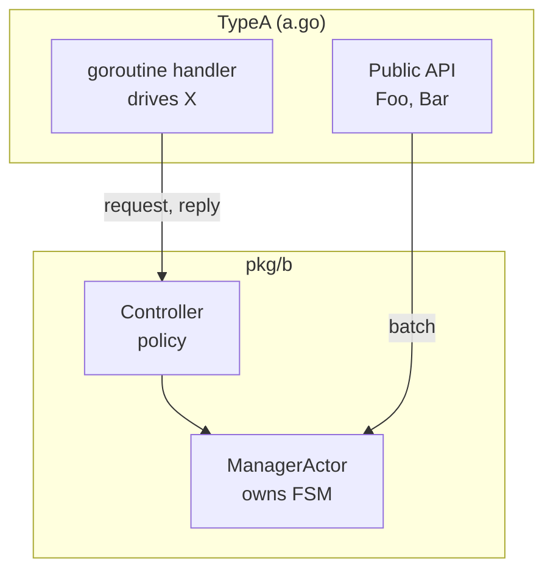
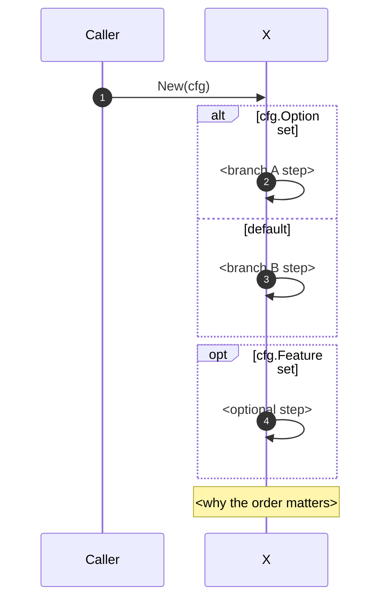
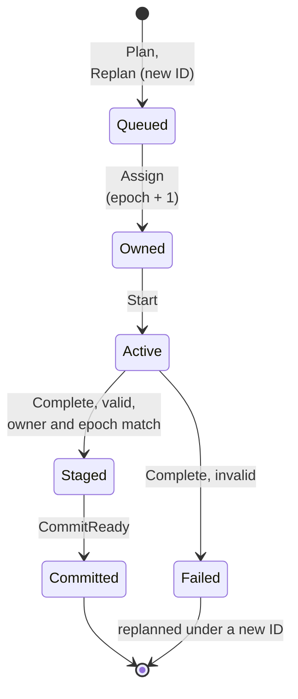
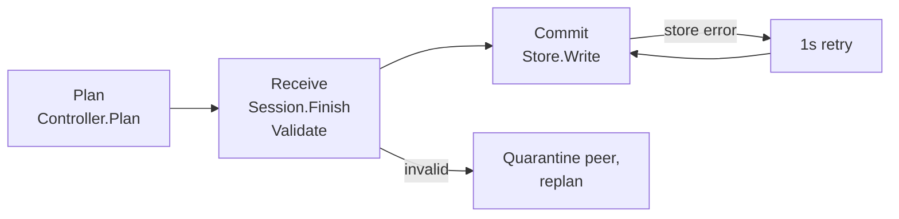
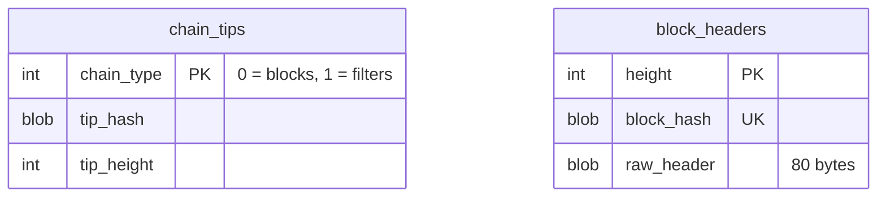

# Skeleton templates

Each template is a shape, not content. Replace every placeholder with real
identifiers from the code. Delete sections the subject lacks.

## Intro

```markdown
# <Subject> Architecture

<Project> keeps <the data or state> in step with <the outside world>. This
document describes the components that do that work, who owns which state, and
how a request moves from <entry point> to <durable result>. It reflects the
code at <commit or PR range>.

For <related topic>, see [<doc>.md](<doc>.md).
```

## Components

Use `flowchart TB` with one subgraph per component. Put the file in the
subgraph title. Label edges with what crosses them.

````markdown

````

Then the table. Every row needs both columns filled; if a type owns nothing
mutable, say so ("Any state of its own" is a valid Owns entry only as a
negative in the other column).

```markdown
| Package or type | Owns | Does not own |
| --- | --- | --- |
| `TypeA` | <state, I/O, ordering it controls> | <what a reader might assume it owns> |
```

## Startup

````markdown

````

## State machine

Name the real states and the real functions. State what changes.

````markdown

````

After it, add: what bypasses the machine, and what invariant spans it (a
lease or epoch rule, an ordering rule).

## Pipeline flowchart

Start at the trigger, end at the durable result, show every failure branch.

````markdown

````

Then a numbered list with bold leads:

```markdown
1. **Plan.** `continueSync` calls `Controller.Plan` while ... It first
   reconciles ... then creates ...
2. **Receive.** `Validate` checks only structure: ...
```

## Peer or connection states

Same `stateDiagram-v2`. Follow with the rule the arrows do not show (for
example, which states allow work to be taken away).

## Storage

```markdown
| Interface | <Backend 1> | <Backend 2> |
| --- | --- | --- |
| `Store` | <file or bucket> | <table> |
```

````markdown

````

Add relationship lines (`a ||--o{ b : "has"`) only where a foreign key
exists. State where there is none and why. Then one paragraph each on: what
one transaction covers, any cache (size, fill width, invalidation), and pragma
or durability settings that change what a crash loses.

For a migration or import, a `sequenceDiagram` with participants for the
entry point, the importer, each source, and the target, followed by one
sentence on retry behaviour and one on what is left in place.

## Concurrency

```markdown
| Goroutine | Owns |
| --- | --- |
| `handler` | <state>; the only caller of <actor> |
| `<actor>`, one per peer | <state> |
```

Then prose rules, each a short paragraph: what timers and callbacks may do
(post a message, never touch state), deadlines on cross-goroutine calls, and
the failure semantics callers get wrong.

## Known gaps

A short bullet list: subsystems not covered, behaviours not confirmed by
running the code, claims that rest on a reader's summary.
